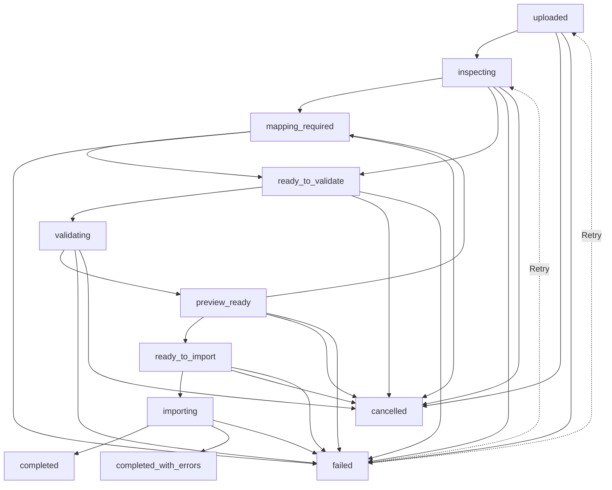

# P14.1 — Resto Import Center Foundation Verification Report

## 1. Final Status
**READY**

All core architectural pillars, database migrations, security controls, state machines, background inspection jobs, OpenAPI definitions, tenant isolation safeguards, and the web UI foundation have been implemented and verified with automated test suites. Existing product, inventory, order, payment, and accounting behaviors remain completely intact and unaffected.

---

## 2. Initial Architecture Findings
- **Backend Architecture**: Laravel 11 REST API operating under clean modular boundaries. Authentication is handled by Laravel Sanctum (`auth:sanctum`), and business isolation is enforced via `TenantMiddleware` and `MembershipContext`.
- **Database & Queue**: PostgreSQL schema in production, SQLite in automated test environment. Queue defaults to `redis` in production/docker and `sync` during testing (`phpunit.xml`).
- **Existing Import Footprint**: Existing `MessageImportController` handles conversational chat text parsing (WhatsApp/Telegram message intake to draft orders). Prior to P14.1, no multi-tenant file migration infrastructure existed for spreadsheets or bulk tabular data.
- **Frontend Architecture**: React 18 TypeScript application with responsive Warm Dark and Light theme tokens (`tokens.ts`), localized in Persian (RTL) and English (LTR).

---

## 3. Implemented Database Migrations and Models

### Database Migration: `2026_10_12_000001_create_import_center_tables.php`
Created four relational tables with cascading foreign keys to `organizations` and `users`:

1. **`import_jobs`**:
   - `id` (UUID, primary key)
   - `organization_id` (foreign key to `organizations`, cascading, indexed)
   - `user_id` (foreign key to `users`, set null on delete)
   - `import_type` (`products`, `customers`, `inventory`, `expenses`, `orders`, `suppliers`, `purchases`)
   - `status` (`uploaded`, `inspecting`, `mapping_required`, `ready_to_validate`, `validating`, `preview_ready`, `ready_to_import`, `importing`, `completed`, `completed_with_errors`, `failed`, `cancelled`)
   - `original_filename`, `detected_format`, `file_size`
   - Progress counters: `total_rows`, `processed_rows`, `valid_rows`, `invalid_rows`, `imported_rows`, `skipped_rows`, `failed_rows`
   - `error_summary`, `idempotency_key`, `mapping_config`, `metadata`
   - `started_at`, `completed_at`, `timestamps`
   - Composite indexes: `[organization_id, status]`, `[organization_id, created_at]`, `[organization_id, idempotency_key]`

2. **`import_sources`**:
   - `id` (UUID, primary key)
   - `import_job_id` (foreign key to `import_jobs`, cascade)
   - `organization_id` (foreign key to `organizations`, cascade)
   - `original_filename`, `storage_path`, `file_format`, `file_size`, `checksum` (SHA-256), `upload_status`, `metadata`

3. **`import_datasets`**:
   - `id` (UUID, primary key)
   - `import_job_id`, `import_source_id`, `organization_id` (foreign keys, cascade)
   - `name` (worksheet/dataset title), `sheet_index`, `row_count`, `headers` (JSON array), `sample_rows` (JSON matrix), `status`, `metadata`

4. **`import_validation_results`**:
   - `id` (UUID, primary key)
   - `import_job_id`, `organization_id` (foreign keys, cascade)
   - `source_file_id`, `worksheet_name`, `row_number`, `field_name`, `original_value`, `error_code` (structured code), `message`, `suggested_action`, `severity` (`error`, `warning`), `is_eligible` (boolean)
   - Composite indexes: `[import_job_id, row_number]`, `[organization_id, error_code]`

### Eloquent Models:
- `App\Models\ImportJob`
- `App\Models\ImportSource`
- `App\Models\ImportDataset`
- `App\Models\ImportValidationResult`

---

## 4. Upload and Storage Security Behavior
Implemented in `App\Services\Import\ImportStorageService`:
- **Private Storage**: Files are stored on private disk (`local`), never exposed publicly. File paths follow `imports/{organization_id}/{uuid}.{ext}`.
- **Path Traversal Protection**: Client-supplied filenames cannot dictate storage paths or directory hierarchies; paths are strictly system-generated UUIDs.
- **Deep Content & Magic Bytes Inspection**:
  - Rejection of executables (`ELF`, `MZ` Windows PE, Mach-O binaries).
  - Rejection of embedded PHP tags (`<?php`, `<?=`), `<script>` tags, or shell shebangs (`#!/`).
  - Strict ZIP header check (`PK\x03\x04`) and archive integrity check for `.xlsx`.
  - Rejection of macro-enabled workbooks containing `vbaProject.bin`, `vbaData.xml`, or script extensions.
  - CSV files cannot contain binary null bytes (`\x00`).
- **File Limits**: Enforces 20MB file limit with explicit validation error messages.
- **Formula Safety**: Formula evaluations (`<f>` tags) are completely ignored by the parser; only literal values (`<v>`) or shared strings (`<t>`) are read.
- **Tenant-Scoped Download**: The download stream endpoint validates tenant membership and streams files with explicit `Content-Disposition: attachment` headers.

---

## 5. Implemented API Endpoints and OpenAPI Updates

All endpoints require `auth:sanctum`, `EnsureUserIsActive`, and `TenantMiddleware`:

| Method | Endpoint | Permission | Description |
|---|---|---|---|
| `GET` | `/api/v1/import/jobs` | `import.view` | List paginated import jobs for active tenant |
| `POST` | `/api/v1/import/jobs` | `import.manage` | Create import job, store source file, enqueue inspection |
| `GET` | `/api/v1/import/jobs/{id}` | `import.view` | Retrieve import job details, datasets, and summary |
| `GET` | `/api/v1/import/jobs/{id}/progress` | `import.view` | Retrieve real-time progress counters and status |
| `POST` | `/api/v1/import/jobs/{id}/cancel` | `import.manage` | Cancel an active, cancellable import job |
| `GET` | `/api/v1/import/jobs/{id}/errors` | `import.view` | Paginated validation errors and warnings report |
| `GET` | `/api/v1/import/jobs/{id}/download` | `import.view` | Securely stream the original uploaded source file |

- **OpenAPI 3.0.3**: Updated `docs/api/openapi.yaml` with all seven paths, parameters, request bodies (including multipart/form-data), and complete response schemas (`ImportJob`, `ImportSource`, `ImportDataset`, `ImportValidationResult`).

---

## 6. Job Lifecycle and Supported State Transitions

Managed by `App\Services\Import\ImportStateMachine` and `App\Support\Import\ImportStatus`:

- **Cancellation Rules**: Permitted only in non-terminal, pre-commit states (`uploaded`, `inspecting`, `mapping_required`, `ready_to_validate`, `validating`, `preview_ready`, `ready_to_import`).
- **Terminal States**: `completed`, `completed_with_errors`, and `cancelled` cannot transition or be cancelled again.
- **Transition History**: Each transition appends an audit entry (`from`, `to`, `reason`, `timestamp`) into `metadata['transition_history']`.

---

## 7. Tenant-Isolation Controls
- Authentication is verified against Sanctum session records.
- Tenant resolution uses `MembershipContext::activeOrganizationId($request)`.
- `TenantMiddleware` rejects requests attempting to query organizations where the user has no active membership (returns HTTP 403).
- All queries to `import_jobs`, `import_sources`, `import_datasets`, and `import_validation_results` are explicitly scoped by `organization_id`.
- Foreign organization queries for `/import/jobs/{id}`, `/download`, or `/cancel` return HTTP 404/403.

---

## 8. Idempotency Behavior Actually Implemented
- **Operation-Level Idempotency**:
  - `ImportJobService` checks `organization_id` + `idempotency_key`.
  - Re-sending the same creation request with the same idempotency key returns the existing job record without re-uploading duplicate storage files or creating duplicate jobs.
  - Global `IdempotencyMiddleware` (`X-Idempotency-Key` header) operates across the API layer with cached HTTP response replay.

---

## 9. Queue and Retry Behavior
- **Queue Worker**: `App\Jobs\InspectImportJob` dispatched via standard Laravel queue (`ShouldQueue`).
- Configured with `$tries = 3` and `$timeout = 120`.
- Safe retry handling: Checks job status upon start; if not in `uploaded`, it logs and safely bails without duplicating processing.
- Handles unexpected exceptions gracefully: logs error without leaking database passwords or internal server paths, and transitions job to `failed`.

---

## 10. Web UI Work Actually Completed
- **Navigation**: Added "مرکز درون‌ریزی داده‌ها" / "Import Center" item with icon `📥` under "مالی و تنظیمات" in `TenantAppShell.tsx`.
- **Routing**: Added `/app/imports` route in `BusinessApp.tsx`.
- **Page Component**: `web/src/pages/ImportCenterPage.tsx`:
  - Full RTL/LTR and Persian/English localization.
  - Dark and Light theme integration using centralized `useTheme` tokens.
  - Real migration history table: shows filename, detected format, data type, status badge, row count, file size, creation timestamp.
  - Real upload modal: file picker restricted to `.xlsx` and `.csv`, domain selector (Products, Customers, Inventory, Expenses, Orders, Suppliers, Purchases), size warnings, upload submission via `FormData`.
  - Real details modal: displays discovered worksheets/tables, row counts, and column headers.
  - Cancellation action for cancellable jobs with user confirmation.
  - Zero fake mock completions or hardcoded fake percentages.
- **Client Methods**: Added `getImportJobs`, `getImportJob`, `createImportJob`, `cancelImportJob`, `getImportJobProgress`, `getImportJobErrors` to `web/src/api/apiClient.ts`.
- **Build Verification**: Both `build:business` and `build:admin` compile with exit code 0.

---

## 11. Automated Tests Executed and Exact Results

### Backend Automated Tests
- **Import Center Foundation Tests** (`backend/tests/Feature/ImportCenterFoundationTest.php`):
  - `✓ unauthenticated requests are rejected`
  - `✓ authorized tenant user can access own import jobs`
  - `✓ tenant user cannot access another tenants import job`
  - `✓ supplied tenant id without membership is forbidden`
  - `✓ unsupported file formats are rejected`
  - `✓ suspicious executable script content is rejected`
  - `✓ macro enabled xlsx workbook is rejected`
  - `✓ original filename does not control storage path`
  - `✓ repeated request with same idempotency key returns existing job`
  - `✓ job state machine valid and invalid transitions`
  - `✓ cancellable job can be cancelled and terminal job cannot`
  - `✓ csv inspection extracts headers and row count`
  - `✓ xlsx inspection extracts worksheets and headers`
  - `✓ inspect import job queue handler updates database records`
  - `✓ authorized download returns file stream`
  - **Result: 15 passed, 52 assertions**

- **Full Backend Test Suite** (`php artisan test`):
  - **Result: 135 passed, 587 assertions (100% pass)**

### Web Frontend Automated Tests
- **Web Test Suite** (`npm test`):
  - `ImportCenterPage.test.tsx` (3 passed)
  - `App.test.tsx` (44 passed)
  - **Result: 47 passed (100% pass)**

---

## 12. Commands Executed and Exit Codes

| Command | Working Directory | Exit Code | Outcome |
|---|---|---|---|
| `git status` | Workspace root | 0 | Checked status |
| `git branch --show-current` | Workspace root | 0 | Verified branch `Products-Customers-Import` |
| `php artisan test` | `backend/` | 0 | Initial test run: 120 tests passed |
| `npm test` | `web/` | 0 | Initial web test run: 44 tests passed |
| `php artisan test --filter=ImportCenterFoundationTest` | `backend/` | 0 | 15 new feature tests passed |
| `php artisan test` | `backend/` | 0 | Full suite: 135 tests passed |
| `npm test` | `web/` | 0 | Full web suite: 47 tests passed |
| `npm run build` | `web/` | 0 | Production bundles built successfully |

---

## 13. Known Limitations
1. **Spreadsheet Formats**: P14.1 strictly supports `.xlsx` and `.csv`. Older binary `.xls` (BIFF8) files are not supported in this phase.
2. **Virus/Antivirus Scanning**: The platform currently lacks an external ClamAV daemon. Deep MIME, magic byte, ZIP traversal, script tag, and VBA macro checks are enforced at application level, but binary malware scanning is documented as deferred.
3. **Chunked Resumable Uploads**: Very large workbooks (>20MB) requiring multi-part slice upload across network dropouts are deferred to future phases.

---

## 14. Deferred Functionality
- **P14.2**: Column mapping UI, suggested AI/fuzzy mapping, transformation rules, type validation engine.
- **P14.3+**: Actual domain migration commits (writing validated rows into `products`, `customers`, opening `inventory` stock movements, historical orders, or double-entry `journal_entries`).
- **Android Import UI**: Deferred as per mission instructions; web is the primary migration experience.

---

## 15. Invariant Confirmation
Existing product catalog, inventory transactions, sales checkout, double-entry accounting journals, supplier orders, and expense tracking remain 100% intact. P14.1 is strictly the isolated migration foundation and does not bypass domain rules or write arbitrary rows into business tables.

---

## 16. Classification Matrix

| Feature / Component | Status |
|---|---|
| ImportJob, ImportSource, ImportDataset, ImportValidationResult models & tables | **Implemented & Automated-tested** |
| Tenant isolation enforcement across all import routes | **Implemented & Automated-tested** |
| Private storage and anti-traversal security | **Implemented & Automated-tested** |
| Executable, PHP script, and XLSX macro rejection | **Implemented & Automated-tested** |
| Lifecycle state machine & cancellation restrictions | **Implemented & Automated-tested** |
| Operation-level idempotency protection | **Implemented & Automated-tested** |
| Bounded-memory CSV & XLSX inspection service | **Implemented & Automated-tested** |
| Asynchronous queue job (`InspectImportJob`) | **Implemented & Automated-tested** |
| OpenAPI 3.0.3 documentation updates | **Implemented & Manually verified** |
| Web UI Import Center (`ImportCenterPage`) with history & upload modal | **Implemented & Automated-tested** |
| Full web production bundle compilation | **Implemented & Manually verified** |
| Legacy binary `.xls` parser | **Designed but deferred** |
| Column transformation and record commit to business tables (P14.2+) | **Designed but deferred** |
